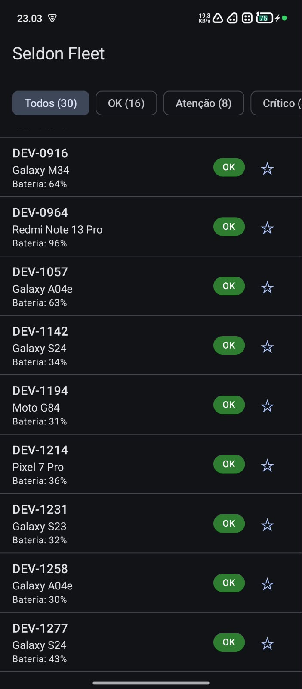
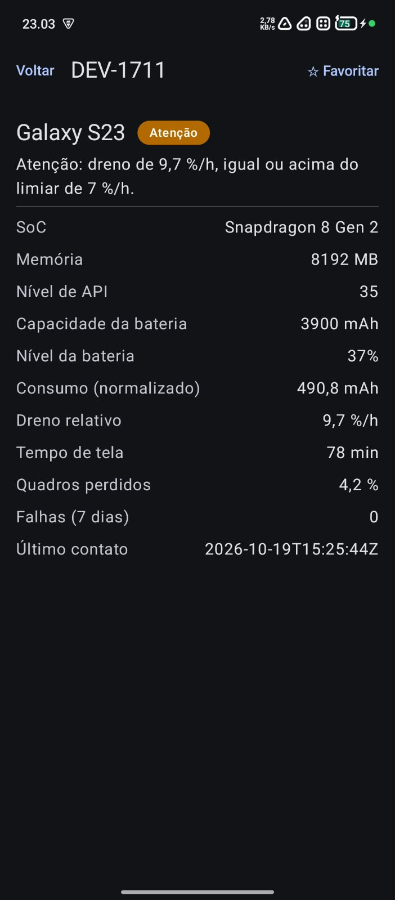

# Seldon Fleet

App Android nativo (Kotlin + Jetpack Compose) que lê um arquivo local de
telemetria, classifica cada dispositivo da frota e explica o motivo de cada
classificação. Funciona totalmente offline.


---

## 1. Visão geral

O app carrega `app/src/main/assets/frota.json` (30 dispositivos), converte as
unidades de energia para mAh, calcula o dreno de bateria por hora de tela e
classifica cada aparelho como **OK**, **Atenção**, **Crítico** ou **Sem dados**.
A regra de classificação vive em uma camada de domínio em Kotlin puro, testada na
JVM, sem emulador.

O raciocínio completo, o tratamento dos defeitos do arquivo e a previsão de
resultado registrada **antes** de executar o app estão em
[PROTOCOLO.md](PROTOCOLO.md).

## 2. Capturas de tela

| Tela 1: lista e filtro por status | Tela 2: detalhe e justificativa |
|:---:|:---:|
|  |  |

- **Lista:** identificador, modelo, bateria e chip de status por dispositivo;
  filtro por status com a contagem de cada estado (Todos 30, OK 16, Atenção 8,
  Crítico 4, Sem dados 2); favoritos com estrela.
- **Detalhe:** atributos do aparelho, consumo já normalizado em mAh, dreno
  relativo e uma justificativa que cita o valor que disparou o status.

## 3. Requisitos e como foram verificados

| Requisito | Como foi atendido e verificado |
|---|---|
| REQ-01 Ingestão local | Dados lidos de `assets/frota.json`; o manifest não declara a permissão `INTERNET` |
| REQ-02 Unidades | Conversão mWh para mAh no mapper; teste que compara o mesmo consumo físico nas duas unidades |
| REQ-03 Registros incompletos | Capacidade 0 ou ausente, tela 0 e energia indisponível viram `INDETERMINADO`, sem divisão; testes cobrem os casos |
| REQ-04 Regra no domínio | Busca por `import android` em `domain/` não retorna nada; testes da regra rodam com `./gradlew test` |
| REQ-05 Lista e filtro | Contagens conferidas no celular: 16 + 8 + 4 + 2 = 30 |
| REQ-06 Detalhe | Justificativa com sinal e valor; o botão voltar mantém o filtro (testado no celular) |
| REQ-07 Favoritos | DataStore; marcações mantidas após encerrar o app (testado no celular) |
| REQ-08 Testes JVM | Conversão de unidade, registros incompletos, fronteiras abaixo e acima de cada limiar, precedência |
| REQ-09 CI | GitHub Actions executa `lintDebug` e `test` a cada push |
| REQ-10 Protocolo | [PROTOCOLO.md](PROTOCOLO.md) |

## 4. Arquitetura

As dependências apontam para dentro: `ui` e `data` conhecem `domain`; `domain` não
conhece ninguém.

```
app/src/main/java/com/example/seldonfleet/
├── domain/                 Kotlin puro, sem import android.*
│   ├── model/              Device, DeviceStatus, Classification
│   ├── repository/         DeviceRepository, FavoritesRepository (interfaces)
│   └── usecase/            ClassifyDevice (a regra)
├── data/
│   ├── dto/                DeviceDto, FleetDto (espelham o JSON, inclusive os defeitos)
│   ├── mapper/             DeviceMapper (mWh para mAh)
│   ├── source/             FleetJsonParser, AssetFleetSource
│   └── repository/         FleetRepositoryImpl, DataStoreFavoritesRepository
└── ui/
    ├── list/               FleetListViewModel, FleetListScreen
    ├── detail/             DeviceDetailScreen, Justification
    ├── theme/
    ├── StatusChip.kt       rótulos e cores exibidos
    └── FleetApp.kt         navegação
```

O domínio declara as interfaces e a camada `data` as implementa. A injeção é manual:
`MainActivity` monta o ViewModel passando repositório, `ClassifyDevice` e favoritos
pelo construtor. Os nomes de estado do domínio (`OK`, `ATENCAO`, `CRITICO`,
`INDETERMINADO`) não são os textos da tela; os textos ("Atenção", "Sem dados") ficam
só em `ui/`.

## 5. Como executar, testar e verificar

**Executar:** abrir no Android Studio, aguardar o Gradle Sync, conectar um celular
com depuração USB (ou usar emulador) e rodar a configuração `app`.

**Testes (JVM, sem emulador) e análise estática:**

```
./gradlew test
./gradlew lintDebug
```

(No Windows PowerShell: `.\gradlew test` e `.\gradlew lintDebug`.)

**Domínio sem dependência de Android (REQ-04):**

```
grep -r "import android" app/src/main/java/com/example/seldonfleet/domain/
```

No PowerShell:

```
Get-ChildItem app\src\main\java\com\example\seldonfleet\domain -Recurse | Select-String "import android"
```

O resultado esperado é uma saída vazia.

## 6. Decisões de projeto e trade-offs

- **Regra de referência, sem limiares próprios.** Preferi uma regra simples, coberta
  por testes de fronteira, a uma regra autoral que eu não conseguiria validar no
  prazo. Os limiares são inclusivos (`>=`).
- **Registro incompleto vira "Sem dados".** O aparelho continua na lista e as
  contagens somam o total do arquivo. Excluir esconderia um dispositivo da frota;
  falhar na ingestão derrubaria a lista por causa de um registro.
- **Conversão de unidade no mapper.** O domínio só enxerga mAh. Se a unidade for
  mWh sem tensão válida, a energia fica nula e o aparelho é "Sem dados"; nenhum
  valor é inventado.
- **Justificativa estruturada.** O domínio devolve sinal, valor observado e limiar;
  a UI monta a frase. Assim o texto exibido não vaza para o domínio.
- **Filtro no ViewModel.** É o que mantém o filtro ao voltar do detalhe.
- **Android Lint como análise estática.** É o que o projeto já traz; o custo é não ter
  as regras de estilo do ktlint ou do detekt.
- **Interface mínima.** Priorizei domínio, testes e documentação.
- **Trilhas opcionais:** nenhuma foi feita.

## 7. Problemas de projeto e como foram resolvidos

1. **Unidades misturadas.** Dez dos 30 registros vêm em mWh. Sem converter, 8 deles
   mudariam de status (o DEV-0204, por exemplo, sairia de OK para Crítico, a 24,3 %/h).
   Solução: converter no mapper antes de qualquer cálculo, com teste de equivalência
   entre mAh e mWh.
2. **Divisores nulos.** O DEV-0311 tem capacidade 0 e o DEV-0745 tem tela 0.
   Solução: o `ClassifyDevice` avalia primeiro os dados insuficientes e devolve
   `INDETERMINADO` antes de qualquer divisão. Custo conhecido: o DEV-0311 tem jank de
   11,2 % e uma falha, sinais que o levariam a Atenção, e ficam encobertos.
3. **Limiares que os dados não exercitam.** Nenhum registro do arquivo tem 3 ou mais
   falhas nem jank a partir de 15 %; todo Crítico do arquivo vem do dreno. Esses
   limiares só são exercitados pelos testes.

## 8. Uso de IA

Usei o Claude (Anthropic) do começo ao fim. Eu não tinha experiência com Kotlin nem
com Android Studio ao começar. A IA me ajudou a entender o enunciado, definiu a ordem
de trabalho e escreveu a maior parte do código Kotlin, dos testes e do arquivo de CI,
que eu fui criando no projeto, executando e corrigindo.

O que fiz eu mesmo: montar o ambiente e o repositório; rodar a suíte e a CI;
instalar e executar o app no meu celular; conferir as contagens e as justificativas
contra a previsão do protocolo; testar a persistência dos favoritos e o filtro ao
voltar do detalhe; verificar o manifest e a ausência de `import android` no domínio;
e definir o escopo (regra de referência, "Sem dados" para registros incompletos,
nenhuma trilha opcional).

## 9. O que eu faria em seguida

- Adicionar detekt ou ktlint à CI, hoje só há o Android Lint.
- Testes automatizados do ViewModel e da persistência dos favoritos (a persistência
  foi verificada manualmente).
- Validar campos obrigatórios no parser: o Gson ignora a nulidade do Kotlin, então
  um campo ausente só falharia mais tarde.
- Mensagem de erro mais específica quando a carga falha.
- Formatar o "último contato" (hoje em ISO-8601) e mover os textos para `strings.xml`.
- Revisar `allowBackup` no manifest, que está no padrão do template.
- Avaliar uma trilha, por exemplo uma segunda regra por percentil da frota comparada
  com a regra de referência.